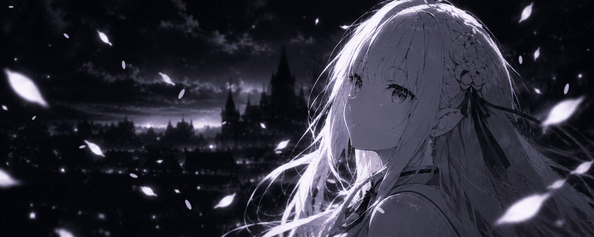

  

<table align="center">
  <tr>
    <td width="60%" valign="center">
      <h1>Hey, I'm Saeed</h1>
      
<strong>Building things, one commit at a time.</strong>

      

        
        
        
        
        
      

       
      <blockquote>
        <i>“Even in the darkest of nights, I'll keep believing in a brighter tomorrow.”</i>
        
— Re:ZERO · エミリア

      </blockquote>
    </td>
    <td width="40%" valign="center">
      

        — SYSTEM STATUS —
      

      <pre><code>┌─ sseanin@paradise-city ──────────
│
│  USER        : saeed
│  CLASS       : engineer
│  WORLD       : use-your-illusion
│  STATUS      : online
│  MOOD        : ./nightrain --loud
│
└─ $ _</code></pre>
      

        静かな夜、遠い夢。
      

    </td>
  </tr>
</table>
